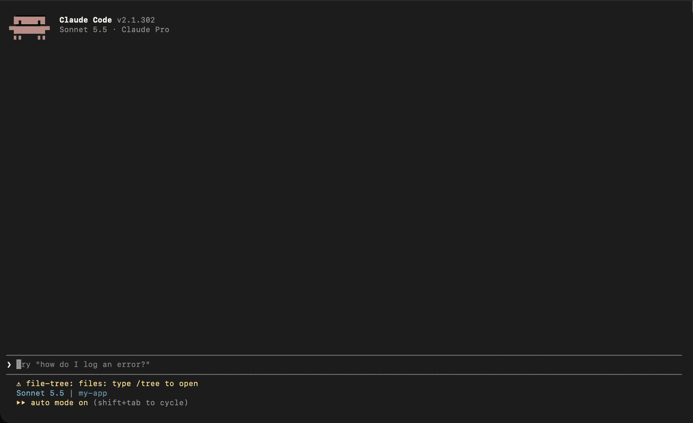

# file-tree

A file tree and file preview inside Claude Code. Type `/tree`, browse your project, and read any file without leaving the session.

 



## Install

```
claude plugin marketplace add Aristere/termichy
claude plugin install file-tree@termichy
```

Start a new session after installing. Nothing opens by itself. Type `/tree` when you want the pane.

## Use

| Command | What it does |
| :- | :- |
| `/tree` | Opens the file tree pane. |
| `/tree setup` | Optional. Asks how wide the pane should be and when it opens. |

Once the pane is open:

- Press `ctrl+x` then `Tab` to move the keys into the pane. `Esc` hands them back to the prompt.
- `↑` and `↓` (or the mouse wheel) move through the rows. `Enter` opens a folder or a file.
- Open a file to preview it. `Tab` moves into the preview, where the arrows, `PageUp` and `PageDown` scroll it. Press `Tab` again to go back to the tree.
- You can also click any row, or click the scrollbar to jump through a long file.

## What you see

- **Text files** open with line numbers, syntax colors and a scrollbar. Long lines wrap.
- **Images** show as a picture (macOS only).
- **Everything else** (binaries, video, files too big to read) shows a short summary and buttons to open or reveal the file.
- **Folders** expand and collapse in place. Symlinks, unreadable files and odd names are handled without breaking the tree.

## Setup

The defaults work, so setup is optional. Run `/tree setup` to answer two questions in plain words:

- **How wide should the file tree be?** Slim, Balanced or Roomy.
- **When should the file tree open?** Automatically when a session starts, or only when you type `/tree`.

Your answers are kept for every session and project. The pane closes and reopens so the new width applies right away. Run `/tree setup` again to change them. The same two settings are in `/config`, under "Pane width" and "Open on session start".

## Data

The plugin makes no network requests and sends nothing anywhere. It reads files under the folder you opened to draw the tree and the preview, and it runs `sips` (images, macOS only), `head` (large text files) and `open`, `xdg-open` or `explorer` (the open and reveal buttons) on your machine. It never writes to your project.

What it hooks and sets:

- `command.run` for `/tree` only. It opens the pane and handles `/tree setup`. It does not touch any other command or any permission prompt.
- `tool.call`, only to redraw the tree after a tool may have changed files. It reads no tool input or output and passes every call on unchanged.
- `/tree setup` writes two plugin settings with `config.set`: `file-tree.width` and `file-tree.openOnStart`. Nothing else is set, and no environment variables.
- It reads no credentials, tokens or API keys, and nothing it reads is sent anywhere.

It stores three things locally: your two setup answers (in `~/.claude/settings.json`), a flag that the first-run tip was shown (in `~/.claude/plugins/store/`), and the pane width if you drag it (kept by Claude Code in its own user settings).

## Requirements

Claude Code 2.1.302 or later. The pane docks beside the conversation in a terminal at least 110 columns wide.

## Troubleshooting

**The width I picked has no effect.** A width you dragged the pane to yourself wins over the setup choice. Drag the pane to the width you want.

**Images show as a summary.** Image previews use macOS `sips`. On Linux and Windows an image shows the summary with open and reveal buttons.

## License

MIT
